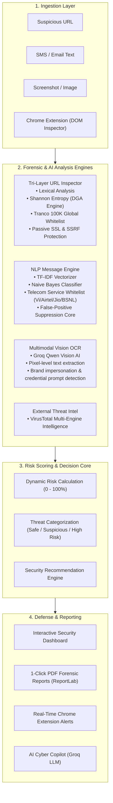

# 🛡️ PhishShield AI
**Enterprise-Grade Multimodal Phishing Detection, Browser Security & Digital Forensics Platform**

[](https://www.python.org/)
[](https://flask.palletsprojects.com/)
[](https://flask-sqlalchemy.palletsprojects.com/)
[](https://groq.com/)
[](https://developer.chrome.com/docs/extensions/)
[](#)

---

## 📖 Overview

**PhishShield AI** is an advanced, multi-tiered cybersecurity platform designed to combat modern zero-day phishing attacks, deceptive URLs, malicious domain generation algorithms (DGAs), and fraudulent screenshots.

By synthesizing **classical machine learning (TF-IDF + Naive Bayes)**, **lexical heuristics**, **Shannon entropy calculations**, **Tranco 100K domain whitelisting**, **real-time DOM forensics**, and **multimodal Vision AI (Groq Qwen-3.8-27b)**, PhishShield AI provides enterprise-grade protection for both web applications and browser endpoints.

---

## 🏗️ System Architecture



---

## 🚀 Key Modules & Capabilities

### 1. 👁️ Multimodal Vision AI OCR (Screenshot Forensics)
- **Pixel-Level Inspection:** Upload screenshots of suspicious SMS messages, emails, QR codes, or fake login portals.
- **Deep Vision OCR:** Powered by the ultra-fast **Qwen-3.8-27b Vision model via Groq Cloud**, instantly extracting obscured or image-embedded text.
- **Threat Recognition:** Automatically identifies brand impersonation (e.g., SBI, HDFC, PayPal, Microsoft), urgent psychological triggers, and hidden credential harvesting fields directly from image pixels.

### 2. 🌐 Tri-Layer URL & DGA Detection Engine
- **Lexical Mutation Parsing:** Flags IP address routing, URL shortening abuse, excessive subdomains, hexadecimal encoding, and homoglyph/typosquatting attacks.
- **Shannon Entropy & DGA Filter:** Evaluates character randomness, vowel-to-consonant ratios, and consonant clustering to identify **Algorithmically Generated Domains (DGA)** used by command-and-control botnets.
- **Tranco Top 100,000 Whitelist:** Validates domains against the authoritative Tranco global 100K list to eliminate false positives on legitimate websites.
- **Passive SSL & SSRF Shield:** Safely extracts SSL certificate validity and DNS metadata without exposing clients to Server-Side Request Forgery.

### 3. 📱 NLP Message Engine with Telecom False-Positive Suppression
- **Machine Learning Classifier:** Employs **TF-IDF vectorization** with a **Multinomial Naive Bayes** classifier trained on over 5,500 labeled phishing, spam, and benign SMS/email samples.
- **Telecom Provider Intelligence:** Specially calibrated to recognize authentic transactional SMS patterns from licensed telecom operators (Vi, Airtel, Jio, BSNL) for standard recharges and data balance alerts.
- **Precision Threat Differentiation:** Suppresses false alarms for benign utility messages while aggressively flagging fake KYC suspension, SIM deactivation threats, unverified APK links, and bank fraud lures.

### 4. 🧩 Manifest V3 Chrome Extension (Real-Time Endpoint Protection)
- **Live DOM Forensics:** Evaluates web pages directly inside Google Chrome for hidden iframes (clickjacking), cross-domain password submission forms, and obfuscated redirects.
- **Local In-Memory Cache:** Remembers scan outcomes with a 1-hour TTL cache to ensure zero-latency responses on frequently visited websites.
- **Rate-Limited API Integration:** Connects securely to the Flask backend with rate limiting to prevent client-side abuse.

### 5. 🤖 Context-Aware AI Cyber Copilot
- Features an embedded cybersecurity assistant powered by Groq LLMs.
- Analyzes individual scan telemetry, explains technical indicators in plain language, and provides actionable remediation guidance.

### 6. 📄 Automated Forensic PDF Export
- Instantly generates client-ready, tamper-evident forensic PDF reports using **ReportLab**.
- Documents timestamped scan parameters, threat score breakdowns, lexical flags, SSL status, and recommended defensive playbooks.

---

## 📂 Project Structure

```text
AI-Based Phishing Detection and URL Risk Analysis System/
├── app_sqlalchemy.py           # Production Flask entry point (Flask-SQLAlchemy ORM)
├── app.py                      # Core application logic & API endpoints
├── dga_detector.py             # DGA botnet detection engine & Tranco 100K whitelist
├── models.py                   # SQLAlchemy database models (Scans, Users, Feedback)
├── requirements.txt            # Python dependencies
├── .env.example                # Sample environment variables template
├── .gitignore                  # Git exclusion rules (safeguarding models, keys & data)
│
├── models/                     # Trained Machine Learning Artifacts
│   ├── phishing_model.pkl      # Trained NLP classifier
│   └── vectorizer.pkl          # Pre-fitted TF-IDF vectorizer
│
├── chrome_extension/           # Google Chrome Extension (Manifest V3)
│   ├── manifest.json           # Extension configuration & permissions
│   ├── popup.html              # Modern glassmorphism UI popup
│   ├── popup.js                # Extension logic & backend API communication
│   ├── content.js              # DOM scanner (iFrames, external password forms)
│   ├── background.js           # Service worker & badge notifications
│   └── icons/                  # Extension icons
│
├── templates/                  # Responsive Web Dashboard (HTML5 + Jinja2)
│   ├── index.html              # Main landing & multi-scanner interface
│   ├── dashboard.html          # Real-time analytics, statistics & charts
│   ├── history.html            # Scan history audit logs & PDF export links
│   ├── text_scan.html          # SMS & Email NLP analyzer
│   ├── screenshot_scan.html    # Multimodal Vision AI screenshot scanner
│   └── login.html              # Admin authentication portal
│
└── static/                     # Web Assets
    ├── css/                    # Custom stylesheets & responsive design
    └── js/                     # Client-side scripts, charts & AJAX handlers
```

---

## ⚡ Quickstart & Installation

### 1. Clone Repository & Setup Virtual Environment
```bash
git clone https://github.com/Safiq417/AI-Based-Phishing-Detection.git
cd AI-Based-Phishing-Detection

# Create virtual environment
python -m venv venv

# Activate virtual environment
# On Windows:
venv\Scripts\activate
# On Linux / macOS:
source venv/bin/activate
```

### 2. Install Required Dependencies
```bash
pip install -r requirements.txt
```

### 3. Configure Environment Variables
Create a `.env` file in the project root directory (refer to `.env.example`):
```env
# Flask Application Secret
SECRET_KEY=replace_with_a_secure_random_key

# Groq Cloud API Key (Required for Multimodal Vision OCR & AI Copilot)
GROQ_API_KEY=gsk_your_groq_api_key_here

# VirusTotal API Key (Optional, for deep multi-engine intelligence)
VIRUSTOTAL_API_KEY=your_virustotal_api_key_here

# Database Configuration (Defaults to local SQLite)
DATABASE_URL=sqlite:///database/phishshield.db
```

### 4. Launch the Application
```bash
python app_sqlalchemy.py
```
*The local development server will start at `http://127.0.0.1:5000`.*

---

## 🧩 Installing the Chrome Extension

1. Launch Google Chrome and navigate to `chrome://extensions/`.
2. Enable the **"Developer mode"** toggle in the top-right corner.
3. Click the **"Load unpacked"** button.
4. Select the `chrome_extension` directory located inside this project folder.
5. Pin **PhishShield AI** to your Chrome toolbar and begin real-time browsing protection.

---

## 📡 API Reference

### 1. Scan URL
- **Endpoint:** `POST /api/scan/url`
- **Payload:** `{"url": "https://example-suspicious-domain.com"}`
- **Response:**
```json
{
  "url": "https://example-suspicious-domain.com",
  "risk_score": 85.0,
  "risk_level": "High Risk",
  "reasons": [
    "DGA pattern detected (High Shannon Entropy: 4.12)",
    "Domain not in Tranco Top 100K Whitelist",
    "Missing or untrusted SSL certificate"
  ],
  "ssl_valid": false,
  "cached": false
}
```

### 2. Scan Text (SMS / Email)
- **Endpoint:** `POST /api/scan_text`
- **Payload:** `{"text": "Urgent: Your SIM will be blocked today! Update KYC immediately at http://bit.ly/fake-kyc"}`
- **Response:**
```json
{
  "risk_score": 92.5,
  "risk_level": "High Risk",
  "threat_type": "Fake KYC Phishing / Urgent Credential Lure",
  "extracted_urls": ["http://bit.ly/fake-kyc"],
  "telecom_verified": false
}
```

### 3. Multimodal Screenshot Analysis
- **Endpoint:** `POST /api/scan_screenshot`
- **Payload:** `multipart/form-data` with `file: <image>`
- **Response:**
```json
{
  "extracted_text": "Dear customer, your bank account has been locked. Verify here.",
  "ocr_model": "Groq Qwen-3.8-27b Vision",
  "risk_score": 88.0,
  "risk_level": "High Risk",
  "brand_impersonation": "Banking Fraud",
  "recommendations": ["Do not click on links", "Verify directly through official mobile banking app"]
}
```

### 4. Forensic PDF Export
- **Endpoint:** `GET /export-pdf/<scan_id>`
- **Response:** Application binary stream (`application/pdf`) containing structured forensic report.

---

## 🛡️ Security & Hardening Controls

- **SQL Injection Prevention:** Built on **Flask-SQLAlchemy ORM** with parameterized queries across all database operations.
- **Rate Limiting:** Guarded by **Flask-Limiter** on scan endpoints to resist brute-force and Denial-of-Service attacks.
- **Cross-Site Scripting (XSS) & CSRF Defense:** Secured via Jinja2 auto-escaping, Flask-WTF tokens, and defensive Content Security Policy headers.
- **SSRF Immunity:** Outbound URL validation blocks internal private IP spaces (`127.0.0.1`, `10.0.0.0/8`, `192.168.0.0/16`, `169.254.169.254`).

---

## 👥 Contributors & Acknowledgements

Developed by **Safiq Ansari & Team**.

*Special thanks to open-source cybersecurity intelligence initiatives including Tranco List, VirusTotal API, and Groq Cloud for accelerated model inference.*
